# Agentic Design Patterns — Study Notes + YouTube Tutorial Series Plan

I’m treating the book’s **21 numbered chapters as the 21 design patterns**, in the exact order of the PDF. The book explicitly describes these as 21 core patterns and organizes one pattern per chapter. 

### Book vs. linked video

The linked Mark Kashef video deliberately condenses the book into **20 patterns**. Near the end, he explicitly says the book contains 21 and that he **excluded MCP because he had covered MCP elsewhere** (video ~1:02:12). ([LilysAI][1]) The video also reverses one pair from the book: it presents **Evaluation & Monitoring at 49:57 before Guardrails & Safety at 52:44**, while the book places Guardrails as Chapter 18 and Evaluation as Chapter 19. ([YouTube][2])

For the tutorial series, I would follow the **book's order**, not the video's numbering. The resulting series is 21 episodes.

---

## 1. Prompt Chaining

**PDF:** Chapter 1, pp. 23–35

* **Overview** — Prompt chaining solves the problem of asking one LLM call to handle too many different constraints or transformations simultaneously. A large task is decomposed into smaller operations; each operation gets a focused prompt, and one step's output becomes the next step's input. The book also calls this the **Pipeline pattern**. 
* A monolithic prompt can neglect instructions, lose context, hallucinate, or fail one part of a multifaceted task. Sequential decomposition reduces the cognitive burden of each call. 

**How it works**

* Components: input → focused stage → validated/structured intermediate state → next stage → final output.
* State is normally the accumulated intermediate artifacts. JSON/Pydantic-style structured outputs are preferable to free text because downstream steps depend on the previous output being parseable. 
* Deterministic Python logic can sit between LLM stages for validation, calculations, branching, cleanup, or retries. 
* The video emphasizes an assembly-line mental model and recommends logging intermediate artifacts so a failure can be traced to its originating stage. Around 03:00–04:40 it also highlights context growth, token cost, error propagation, and added latency. ([LilysAI][1])

**Diagram**

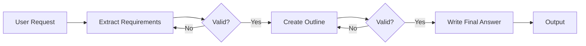

**Benefits / Drawbacks**

* **Benefits:** modular, inspectable, easier to test/debug, stronger instruction adherence, supports deterministic validation between LLM calls. 
* **Cost:** multiple inference calls increase tokens and monetary cost.
* **Latency:** normally higher than one-shot prompting because dependencies are sequential.
* **Failure modes:** bad early output propagates downstream; accumulated context can become large; excessively fine-grained chains become orchestration overhead. The video specifically calls out context explosion, token growth, error propagation, and slower execution. ([LilysAI][1])

**Example use cases**

* Document → summary → entities → database lookup → report.
* Invoice → extract → normalize → calculate → validate.
* Topic → outline → draft → edit.
* Requirements → pseudocode → code → review → tests.
* Multi-modal extraction where image text, labels, and tabular context are interpreted sequentially.  

**Variations**

* Linear pipeline.
* Conditional chain with validation/retry.
* Tool calls between LLM stages.
* Parallel fan-out followed by a sequential synthesis chain.
* Different model/persona at each stage.

**Demo app — “AI Blog Pipeline”**

* **Libraries:** `langchain-core`, `langchain-ollama` or another chat-model package, `pydantic`.
* Input a topic.
* Stage 1: produce structured research questions.
* Stage 2: create an outline.
* Stage 3: draft a short article.
* Stage 4: validate that required headings exist.
* Print every intermediate object so viewers can literally see the chain.

**Episode outline**

* Hook: show a single giant prompt producing an inconsistent response.
* Explain the pipeline model.
* Build three focused chains.
* Pass typed state between them.
* Intentionally break stage 1 and show downstream propagation.
* Add validation and rerun.
* Finish with the rule: **chain when the stages depend on each other; parallelize when they don't.**

---

## 2. Routing

**PDF:** Chapter 2, pp. 36–49
**Video:** ~05:42–09:29

* **Overview** — Routing solves the rigidity of a single predetermined workflow. An agent analyzes an input or its current state and dynamically selects a tool, workflow, function, or specialist agent. 

**How it works**

* Input enters a **router/classifier**.
* Router emits a route identifier plus, ideally, confidence or structured metadata.
* Deterministic code sends the original payload to the chosen branch.
* The selected specialist performs the work.
* Unknown or low-confidence inputs go to clarification, fallback, or human review.
* The book identifies four major router implementations: **LLM-based, embedding-based, rule-based, and trained classifier/model-based**. 
* The video's “smart receptionist” analogy is useful: classify intent, send work to the right department, and quarantine uncertain cases rather than pretending certainty. ~05:42–09:16. ([LilysAI][1])

**Diagram**

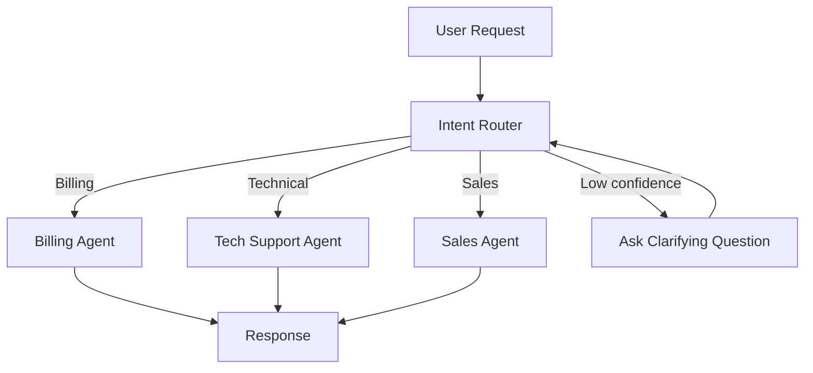

**Benefits / Drawbacks**

* **Benefits:** specialization, smaller prompts/toolsets, flexible control flow, efficient dispatch.
* **Cost:** an LLM router adds another inference call; rules/embeddings can avoid that.
* **Latency:** usually low, but multi-level routers can accumulate latency.
* **Failure modes:** misrouting, ambiguous categories, router hallucination, overconfidence, routes drifting as requirements change. The video specifically warns about wrong paths and edge cases. ([LilysAI][1])
* LangGraph's state-based graph is especially appropriate when routing depends on accumulated workflow state rather than only the latest message. 

**Example use cases**

* Customer-service triage.
* Coding assistant routes debug/explain/translate requests.
* Document pipeline chooses PDF/CSV/JSON processors.
* AI tutor chooses the next learning module.
* Research coordinator chooses search, analysis, or summarization specialist. 

**Variations**

* Hardcoded `if/elif`.
* LLM classifier with structured output.
* Semantic/embedding router.
* Fine-tuned classifier.
* Hierarchical router: domain → specialist.
* Confidence router + HITL fallback.

**Demo app — “AI Help Desk Router”**

* **Libraries:** `langgraph`, `pydantic`, model package.
* Define `billing`, `technical`, `sales`, `unknown`.
* Have the LLM return `category` + `confidence`.
* Use conditional edges to route.
* Force an ambiguous query into clarification.

**Episode outline**

* Compare chaining vs routing.
* Build three specialist nodes.
* Add a Pydantic classification model.
* Add conditional LangGraph edges.
* Test obvious requests.
* Test “My account isn't working and I was charged twice.”
* Show the danger of trusting a router with no confidence/fallback.

---

## 3. Parallelization

**PDF:** Chapter 3, pp. 50–64
**Video:** ~09:30–13:15

* **Overview** — Parallelization runs **independent** LLM calls, tools, or agents concurrently instead of unnecessarily waiting for one another. Its primary goal is reducing end-to-end latency. 

**How it works**

* Decompose a task.
* Build a dependency graph.
* Fan out all independent branches.
* Run them concurrently.
* Normalize their results.
* Wait at a synchronization barrier.
* Fan in to a merger/synthesis step.
* LangChain provides `RunnableParallel`; graph topologies such as LangGraph can fan one state into multiple nodes before converging. 
* Important teaching distinction: Python `asyncio` gives **concurrency**, not CPU-level parallel execution; it is particularly useful for network-bound LLM/API calls. 
* The video additionally stresses normalizing outputs before merging them and keeping provenance back to individual workers. ~09:30 onward. ([LilysAI][1])

**Diagram**

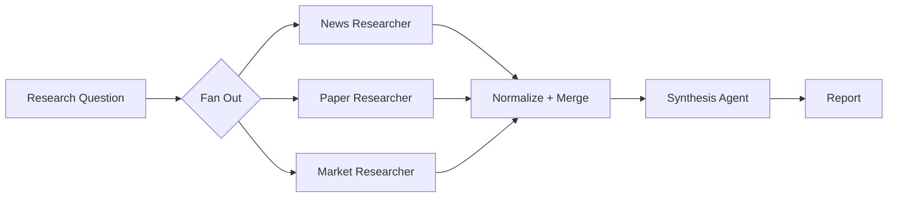

**Benefits / Drawbacks**

* **Benefits:** lower wall-clock latency, higher throughput, natural decomposition, easier specialization. 
* **Cost:** total token/API cost can remain the same or increase even when wall time falls.
* **Failure modes:** rate-limit bursts, one slow branch delaying the join, inconsistent formats, duplicated research, race conditions around shared state.
* **Complexity:** concurrent systems are harder to design, debug, and log. 

**Example use cases**

* Search five independent data sources.
* Sentiment + classification + keywords on feedback.
* Flights + hotels + local events concurrently.
* Generate multiple headlines and select one.
* Run several independent validations simultaneously. 

**Variations**

* Fan-out/fan-in.
* Map-reduce.
* Parallel tool calls.
* Parallel specialist agents.
* Ensemble generation + judge.
* Hybrid: parallel retrieval → chained synthesis/reflection.

**Demo app — “Parallel Research Brief”**

* **Libraries:** `asyncio`, `langchain-core`.
* Three LLM chains: summary, questions, key concepts.
* Use `asyncio.gather()` or `RunnableParallel`.
* Measure sequential vs concurrent runtime.
* Merge into one study brief.

**Episode outline**

* Run three calls sequentially and time them.
* Explain dependency graphs.
* Convert to concurrent execution.
* Show runtime improvement.
* Break one branch and discuss `gather(..., return_exceptions=True)`.
* Normalize branch schemas before synthesis.

---

## 4. Reflection

**PDF:** Chapter 4, pp. 65–78
**Video:** ~13:16–15:50

* **Overview** — Reflection addresses the fact that an agent's first output may be inaccurate, incomplete, or simply mediocre. It adds an explicit **feedback loop** in which work is generated, evaluated, and revised. 

**How it works**

1. Producer generates draft.
2. Critic evaluates against a rubric/tests.
3. Critique becomes new state.
4. Producer revises.
5. Stop when quality criterion or max-iteration limit is reached.

The book recommends separating **Producer** and **Critic** logical roles because a dedicated evaluator can bring a different perspective to the work.  The video similarly describes “critic → revise → pass” and explicitly recommends a maximum iteration count to prevent infinite loops. ([LilysAI][1])

**Diagram**

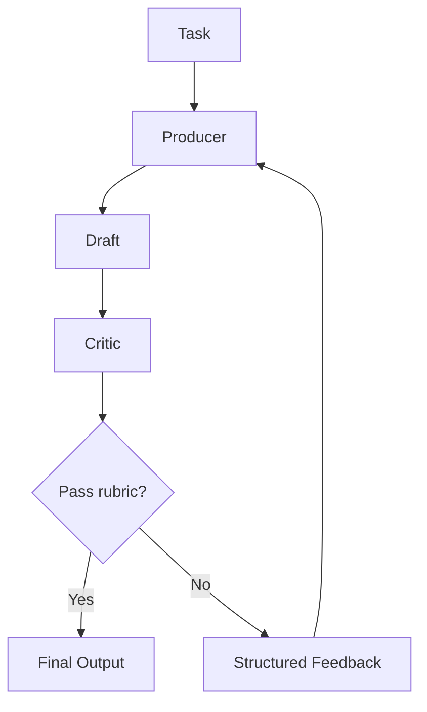

**Benefits / Drawbacks**

* **Benefits:** improved correctness, polish, adherence to constraints, self-correction.
* **Cost/latency:** each loop adds additional inference calls; the book explicitly notes increased cost, latency, and growing history/context. 
* **Failure modes:** endless revision, critic agrees with producer's mistakes, diminishing returns, context-window growth, API throttling. The video highlights both high cost and throttling. ([LilysAI][1])

**Example use cases**

* Code generation + review.
* Blog/article editing.
* Plan feasibility review.
* Document-summary fact/completeness check.
* Logic-puzzle backtracking. 

**Variations**

* Same-model self-reflection.
* Separate Producer/Critic prompts.
* Different models for producer and critic.
* Deterministic tests as critic.
* Multi-critic panel.
* Single revision vs iterative loop.

**Demo app — “Self-Improving Python Coder”**

* **Libraries:** `langgraph`, `pydantic`, `pytest` or simple test functions.
* Agent writes a function.
* Run deterministic tests.
* Critic explains failures.
* Send failures back to generator.
* Max three iterations.

**Episode outline**

* Generate intentionally flawed code.
* Run tests.
* Introduce critic.
* Build cyclic LangGraph edge.
* Demonstrate repair.
* Show why `max_iterations` is mandatory.
* Contrast LLM critique with deterministic unit tests.

---

## 5. Tool Use / Function Calling

**PDF:** Chapter 5, pp. 79–99
**Video:** ~15:51–18:18

* **Overview** — Tool Use lets an LLM reach beyond its static internal knowledge to **retrieve information, calculate, execute code, query databases, or take actions**. 

**How it works**

1. Expose tool definitions/schema.
2. LLM inspects user request.
3. LLM chooses tool and generates structured arguments.
4. Runtime validates/executes the function.
5. Tool result becomes an observation.
6. LLM either answers or chooses another tool. 

The book makes a useful distinction: **function calling** is one implementation, while “tool” is broader and can represent APIs, databases, interpreters, or even another agent.  The video adds an operational sequence of discover → permission/safety check → execute → parse/normalize → fallback. ~15:51–17:31. ([LilysAI][1])

**Diagram**

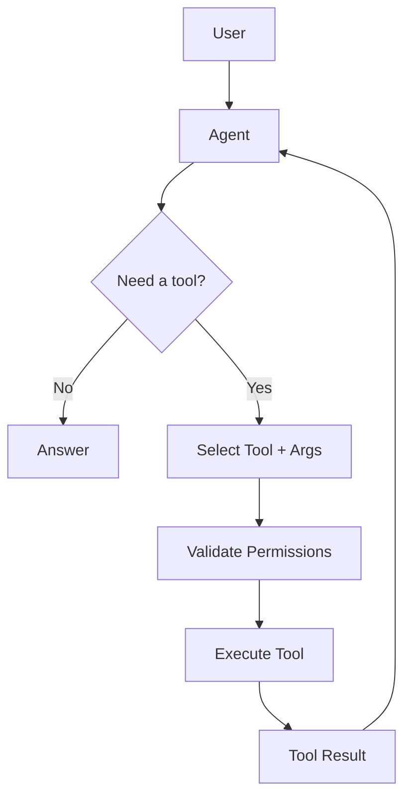

**Benefits / Drawbacks**

* **Benefits:** live information, precise calculation, real-world actions, access to proprietary systems.
* **Latency:** external services add network/tool latency.
* **Cost:** tool APIs may have their own charges in addition to LLM inference.
* **Failure modes:** wrong tool, malformed arguments, permission errors, unsafe side effects, stale/invalid tool outputs, retries repeating a non-idempotent action.
* The video warns that a bad tool decision can propagate through the workflow. ([LilysAI][1])

**Example use cases**

* Weather lookup.
* Inventory/order status.
* Stock data + calculator.
* Send an email.
* Run Python.
* Smart-home control. 

**Variations**

* Native function calling.
* ReAct tool loop.
* Code execution.
* Agent-as-a-tool.
* Read-only vs action tools.
* MCP-exposed tools.

**Demo app — “SQLite Data Agent”**

* **Libraries:** `langchain`, `sqlite3`, `pydantic`.
* Tools: `list_products()`, `lookup_inventory()`, `calculate_total()`.
* Give agent all three.
* Ask natural-language queries requiring one or multiple calls.
* Log every tool decision.

**Episode outline**

* Show a model guessing inventory incorrectly.
* Add a deterministic inventory tool.
* Explain tool schemas.
* Watch generated tool arguments.
* Add a malformed-input test.
* Add read vs write permission boundaries.

---

## 6. Planning

**PDF:** Chapter 6, pp. 100–112
**Video:** ~18:19–20:48

* **Overview** — Planning is used when the desired outcome is known but the **sequence of actions required to reach it is not**. The agent converts a high-level goal into executable steps and can replan when conditions change. 
* The book offers an important decision rule: if the “how” is already reliably known, prefer a fixed workflow; planning adds autonomy and uncertainty that may not be necessary. 

**How it works**

* Goal + initial state + constraints.
* Planner decomposes goal into sub-goals.
* Identify dependencies.
* Assign tools/agents.
* Execute.
* Observe progress.
* Replan after failure/new information.
* The video frames this as creating milestones and a dependency graph, checking budget/authorization/deadlines, then monitoring acceptance criteria. ~18:19–20:13. ([LilysAI][1])

**Diagram**

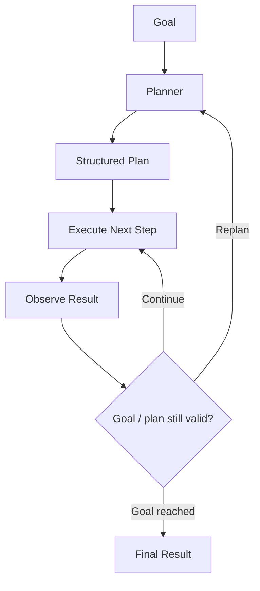

**Benefits / Drawbacks**

* **Benefits:** handles ambiguous multi-step goals, dependencies and changing conditions.
* **Cost:** planning itself consumes tokens; re-planning adds further calls.
* **Latency:** substantial for long-horizon work.
* **Failure modes:** impossible plans, stale assumptions, cascading plan errors, over-planning simple tasks, replanning loops.
* Deep Research is given as an advanced example: create research plan → search → identify gaps → refine queries → synthesize. 

**Example use cases**

* Employee onboarding.
* Research report.
* Travel/offsite planning.
* Multi-step support diagnosis.
* Robot/navigation path generation. 

**Variations**

* Plan-then-execute.
* Incremental planning.
* Planner/executor split.
* Replanning loop.
* Hierarchical planning.
* Human-approved plan before execution.

**Demo app — “Autonomous File Organizer”**

* **Libraries:** `langgraph`, `pydantic`, Python filesystem functions.
* User says “organize these demo files.”
* Planner generates a typed list of moves.
* Human can preview plan.
* Executor performs simulated moves.
* Failure triggers replanning.

**Episode outline**

* Contrast prompt chaining with planning.
* Create a plan schema.
* Generate dependencies.
* Execute one step at a time.
* Simulate missing file.
* Replan.
* Explain when a hardcoded workflow is safer.

---

## 7. Multi-Agent Collaboration

**PDF:** Chapter 7, pp. 113–131
**Video:** ~20:49–23:44

* **Overview** — Multi-Agent Collaboration decomposes complex work among multiple specialized agents, each with defined roles, tools, knowledge, or responsibilities. 
* The video summarizes the common version as “specialists + central manager + shared memory,” using a film crew analogy. ~20:50–21:43. ([LilysAI][1])

**How it works**

* Coordinator receives objective.
* Decomposes or routes sub-tasks.
* Specialists work independently or sequentially.
* Agents exchange artifacts/state.
* Coordinator resolves conflicts and synthesizes.
* Shared state needs namespaces/contracts to prevent one agent's information from contaminating another's.

**Diagram**

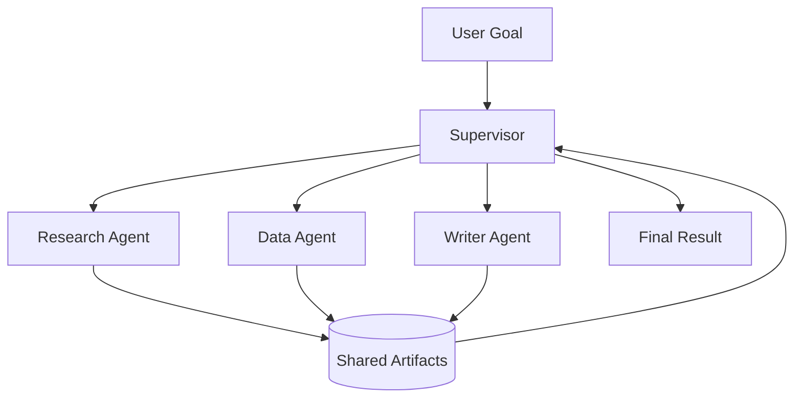

**Benefits / Drawbacks**

* **Benefits:** specialization, modularity, parallelism, independent tool access, fault isolation.
* **Cost:** N agents frequently means substantially more tokens/tool calls.
* **Latency:** coordination rounds, handoffs, debate, and synchronization add delay.
* **Failure modes:** endless delegation, conflicting state, duplicated work, supervisor bottleneck, agents talking past each other.
* The video recommends a maximum retry/coordination count and warns shared memory must be carefully structured. ([LilysAI][1])

**Example use cases**

* Research team.
* Software team: analyst → coder → tester → documenter.
* Marketing campaign team.
* Financial-analysis specialists.
* Supply-chain optimization. 

**Variations**

The book enumerates several useful topologies:

* Sequential handoffs.
* Parallel workers.
* Debate/consensus.
* Supervisor.
* Expert team.
* Critic/reviewer.
* Peer-to-peer network.
* Hierarchical supervisors.
* Supervisor-as-tool.
* Custom hybrids.  

**Demo app — “AI Content Team”**

* **Libraries:** `langgraph`, model package.
* Researcher generates facts from supplied context.
* Writer drafts.
* Reviewer checks constraints.
* Supervisor sends draft back once if necessary.
* Keep shared state as typed Pydantic fields.

**Episode outline**

* Start with one overburdened generalist.
* Split into three roles.
* Add supervisor.
* Show handoffs in graph.
* Demonstrate parallel vs sequential specialists.
* Introduce a shared-state collision.
* Fix it with namespaced fields.

---

## 8. Memory Management

**PDF:** Chapter 8, pp. 132–153
**Video:** ~23:45–26:41

* **Overview** — Memory lets an agent retain and use information from earlier observations, actions, or interactions instead of behaving statelessly. The book separates **short-term/contextual memory** from **long-term/persistent memory**. 

**How it works**

* Short-term: conversation history, recent tool results, active plan/state.
* Long-term: external store containing persistent facts/experiences.
* Before a response, relevant long-term items are retrieved into the active context.
* After interaction, selected new information may be written back.
* Context-window management requires summarizing or discarding less useful history.
* The video usefully classifies memory as short-term, episodic and long-term, with metadata such as recency and relevance; it warns that **what is worth remembering is application-specific**. ~23:38–26:31. ([LilysAI][1])

**Diagram**

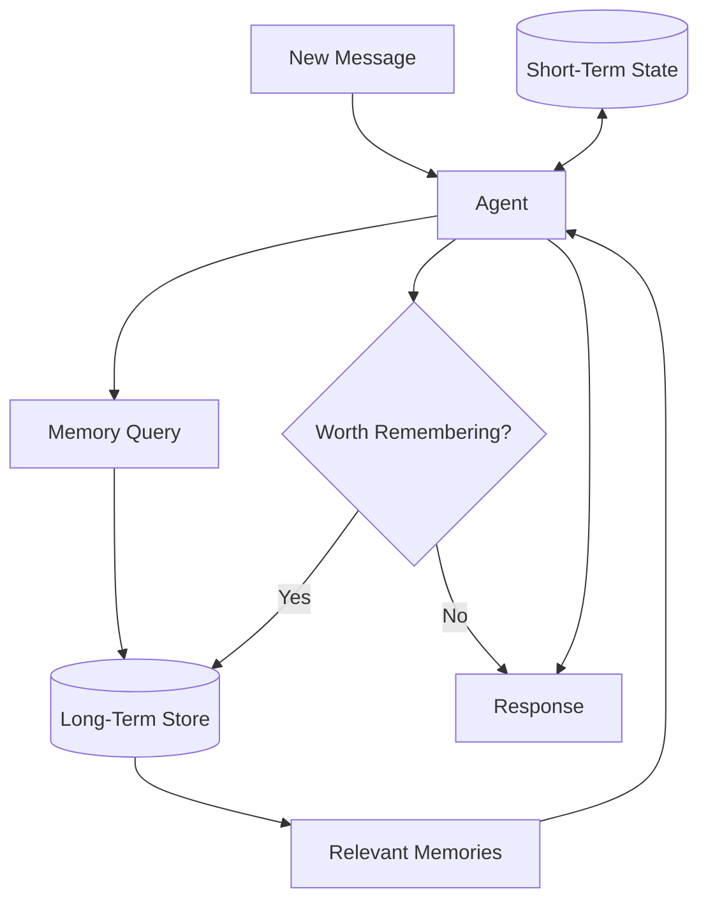

**Benefits / Drawbacks**

* **Benefits:** continuity, personalization, multi-step task state, recall of previous successful strategies.
* **Cost:** storage, embeddings/retrieval, context tokens.
* **Failure modes:** remembering incorrect facts, stale memories, irrelevant retrieval, privacy leakage, memory poisoning, storing everything and overwhelming context.
* The book notes the finite context window and the need for persistent storage beyond the active session. 

**Example use cases**

* Stateful chatbot.
* Long-running task agent.
* Personalized assistant.
* RAG-backed knowledge memory.
* Robot/environment history. 

**Variations**

The book later breaks long-term memory into:

* **Semantic:** facts.
* **Episodic:** experiences/examples.
* **Procedural:** rules/instructions. 

Also:

* Window/buffer memory.
* Conversation summarization.
* Vector memory.
* User profile JSON.
* Session state/checkpoints.

**Demo app — “Study Buddy That Remembers”**

* **Libraries:** `langgraph`, SQLite/in-memory store, embeddings optional.
* Turn 1: user gives preferred programming language.
* Persist semantic fact.
* Start a new thread.
* Retrieve preference automatically.
* Add a `/memories` debug view for teaching.

**Episode outline**

* Show stateless conversation.
* Add thread state.
* Explain context window ≠ durable memory.
* Add long-term store.
* Retrieve across sessions.
* Show bad/stale memory case.
* Discuss deletion, TTL, privacy and relevance scoring.

---

## 9. Learning and Adaptation

**PDF:** Chapter 9, pp. 154–166
**Video:** ~26:42–29:16

* **Overview** — Learning and Adaptation changes an agent's knowledge, strategy, instructions, or behavior using new data and outcomes so it can improve instead of remaining fixed. 
* The book spans reinforcement, supervised, unsupervised, few/zero-shot, online, and memory-based learning. 
* The video's practical version is easier for a tutorial: collect user corrections/ratings/outcomes → clean the feedback → update prompts, policies, or examples → evaluate again. ~26:34–28:52. ([LilysAI][1])

**How it works**

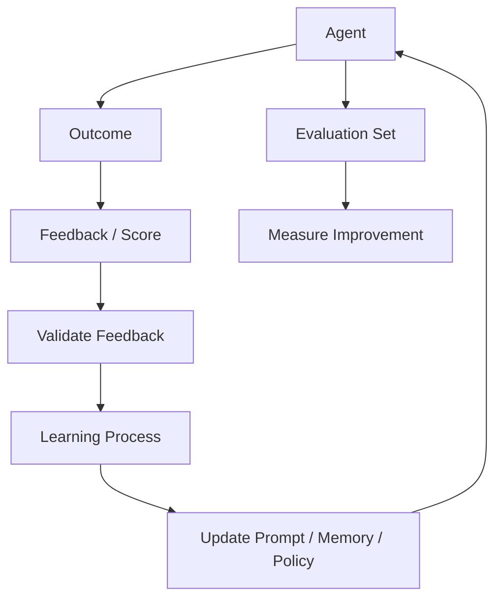

* Capture trajectories/outcomes.
* Validate training signal.
* Derive an update.
* Change prompt, memory, examples, model, policy, or even code.
* Re-evaluate against held-out tasks before deployment.

**Benefits / Drawbacks**

* **Benefits:** personalization, improvement over time, adaptation to changing environments.
* **Cost:** evaluation and training loops may dwarf normal inference cost.
* **Failure modes:** learning from malicious/noisy feedback, catastrophic regressions, reward hacking, drift, self-modification making behavior harder to audit.
* The video explicitly warns an agent can **learn the wrong thing** from bad feedback. ([LilysAI][1])
* The book's SICA example goes as far as an agent modifying its own source code based on benchmark performance. 

**Example use cases**

* Personalized assistant.
* Recommendation agent.
* Fraud detector.
* Adaptive robotics.
* Self-improving coding agent. 

**Variations**

* Prompt/example adaptation.
* Memory-based learning.
* Supervised fine-tuning.
* RL/PPO.
* Preference optimization/DPO.
* Online learning.
* Evolutionary optimization such as AlphaEvolve/OpenEvolve.
* Self-modifying code. 

**Demo app — “Feedback-Learning Support Agent”**

Keep this tutorial much smaller than SICA:

* **Libraries:** `langgraph`, `pydantic`, SQLite.
* Store thumbs-up/down + correction.
* Every five examples, generate a candidate system-prompt improvement.
* Run old vs new prompt against a tiny eval set.
* Only adopt candidate if score improves.

**Episode outline**

* Explain inference-time memory vs actual adaptation.
* Capture feedback.
* Validate feedback.
* Generate revised instructions.
* A/B-test old/new prompt.
* Show malicious feedback poisoning.
* Require eval improvement before promotion.

---

## 10. Model Context Protocol (MCP)

**PDF:** Chapter 10, pp. 167–182
**Video:** **No standalone section**

This is the **one book pattern the linked video intentionally skips**; the presenter says so at ~1:02:12. ([LilysAI][1])

* **Overview** — MCP standardizes how LLM applications communicate with external **tools, resources, and prompts** through a client-server architecture. The book frames it as a universal adapter that avoids building an entirely custom integration for every agent/tool pair. 

**How it works**

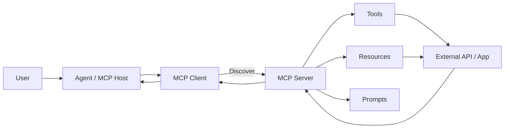

* MCP host/client connects to a server.
* Client discovers capabilities.
* Server exposes tools/resources/prompts.
* Agent chooses capability.
* Client sends standardized request.
* Server authenticates, validates, performs the action, and returns structured results.
* Result enters the agent context. 

**Benefits / Drawbacks**

* **Benefits:** interoperability, dynamic discovery, reusable servers, looser coupling between models and integrations.
* **Cost/latency:** adds protocol/network/runtime layers versus a direct local function call.
* **Failure modes:** unavailable server, authentication failures, overly broad permissions, malformed resources.
* Important book caveat: MCP cannot turn a bad API into a good agent interface. Wrapping a legacy API that returns poor data shapes still leaves the agent with poor data. 
* Security, error handling, and local-vs-remote deployment all require explicit design. 

**Example use cases**

* Database server.
* File-management server.
* Email/CRM tools.
* Generative-media server.
* Internal enterprise knowledge.
* IoT control. 

**Variations**

* Tool vs Resource vs Prompt.
* Local STDIO server.
* Remote HTTP server.
* Read-only vs action server.
* Multiple servers connected to one client.
* Server composition/proxying.
* MCP + A2A: MCP connects agents to capabilities; A2A connects agents to agents.

**Demo app — “Your First Python MCP Server”**

* **Libraries:** `fastmcp`.
* Build a tiny todo server:

  * `list_tasks`
  * `add_task`
  * resource containing project notes
* Connect an MCP client/agent.
* Show discovery before any tool call.

**Episode outline**

* Start with two hand-written tool integrations.
* Explain why N agents × M services becomes integration debt.
* Build FastMCP server.
* Inspect exposed schema.
* Connect a client.
* Add read vs write permissions.
* End with **MCP vs function calling vs A2A**.

---

## 11. Goal Setting and Monitoring

**PDF:** Chapter 11, pp. 183–195
**Video:** ~29:17–31:33

* **Overview** — This pattern gives an agent an explicit definition of **success** and continuously compares actual progress against it. Without a measurable goal, autonomy has no objective stopping or correction mechanism. 

**How it works**

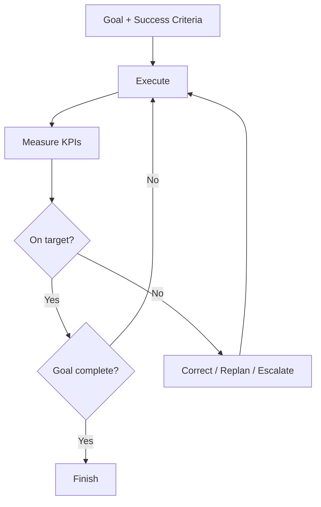

* Define measurable objective.
* Select metrics/KPIs.
* Track actions, environment and tool outputs.
* Compare observations to targets.
* Correct, replan or escalate on deviations.
* The book explicitly recommends SMART-style goals and clear success criteria. 
* The video uses a GPS analogy: destination + KPIs + checkpoints + course correction. ~29:00–31:16. ([LilysAI][1])

**Benefits / Drawbacks**

* **Benefits:** explicit stopping condition, accountability, measurable progress, adaptive course correction.
* **Cost:** continuous evaluation adds tokens/compute.
* **Failure modes:** wrong metric becomes the target; vague goals; evaluator incorrectly says “success”; infinite loop.
* The book specifically warns that an LLM may misunderstand a goal, hallucinate during evaluation, and that using the same LLM as both worker and judge can hide failures. 

**Example use cases**

* Resolve support ticket.
* Tutor student to mastery threshold.
* Finish project milestone by date.
* Portfolio strategy within risk limits.
* Autonomous navigation. 

**Variations**

* Deterministic KPI monitor.
* LLM-as-judge.
* Separate evaluator agent.
* Checkpoint-based monitoring.
* Multiple sub-goals.
* Goal + Reflection hybrid.

**Demo app — “Code Until Tests Pass”**

* User specifies programming task + explicit goals.
* Generate code.
* Run tests.
* Monitor pass rate.
* Feed failures back.
* Stop at 100% or three iterations.

**Episode outline**

* Show an agent that doesn't know when it's done.
* Define goal contract.
* Build evaluator.
* Add loop.
* Demonstrate false-positive LLM judge.
* Replace key success criterion with deterministic tests.

---

## 12. Exception Handling and Recovery

**PDF:** Chapter 12, pp. 196–203
**Video:** ~31:34–34:10

* **Overview** — This pattern makes agent systems resilient to tool failures, network problems, bad outputs, invalid state, and other unexpected conditions. The book organizes it into **detection → handling → recovery**. 

**How it works**

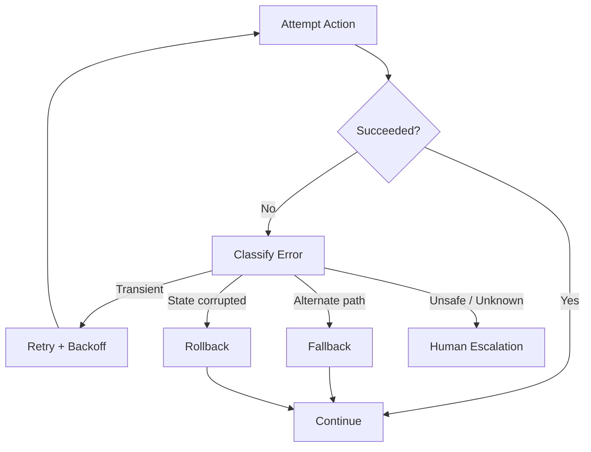

* Detect via status code/schema/timeout/output validation.
* Log diagnostics.
* Classify transient vs permanent/unsafe failure.
* Retry or use fallback.
* Gracefully degrade if necessary.
* Restore a stable state.
* Replan/reflection may attempt a different approach.
* Escalate when autonomous recovery is unsafe. 
* Video summary: “catch errors in your other agentic patterns.” ~31:17–32:49. ([LilysAI][1])

**Benefits / Drawbacks**

* **Benefits:** higher uptime, graceful degradation, safer real-world automation.
* **Latency:** retries directly increase tail latency.
* **Cost:** repeated API/LLM calls cost more.
* **Failure modes:** retry storms, endlessly retrying permanent failures, fallback returning lower-quality data, state corruption, duplicate real-world actions.

**Example use cases**

* Database unavailable.
* Trading API rejects transaction.
* Smart-home device offline.
* Corrupted document in batch.
* Web scraper encounters 503/CAPTCHA.
* Robot misses an object pickup. 

**Variations**

* Retry + exponential backoff.
* Fallback provider/tool.
* Graceful degradation.
* Checkpoint/rollback.
* Reflection after exception.
* Circuit breaker.
* Human escalation.

**Demo app — “Resilient API Agent”**

* **Libraries:** `tenacity`, `langgraph`, `pydantic`.
* Fake a flaky weather/data API.
* Fail first two requests.
* Retry with backoff.
* Switch provider after limit.
* Preserve state and show error trace.

**Episode outline**

* Let agent crash first.
* Classify failures.
* Add retry.
* Add fallback.
* Show why every exception should not retry.
* Discuss idempotency for write actions.

---

## 13. Human-in-the-Loop (HITL)

**PDF:** Chapter 13, pp. 204–212
**Video:** ~34:11–36:00

* **Overview** — HITL deliberately inserts human judgment where autonomous execution is too uncertain, risky, ambiguous, sensitive, or ethically important. 

**How it works**

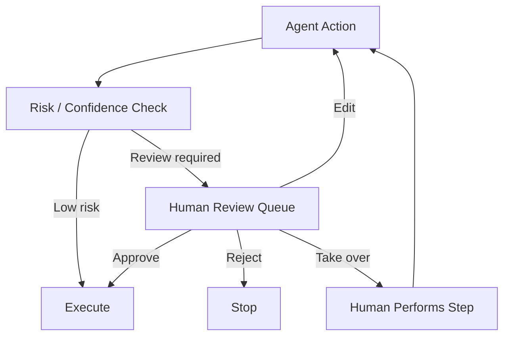

* Agent reaches decision boundary.
* Risk/confidence policy determines whether review is required.
* Save full context and state.
* Human approves, denies, edits, or takes over.
* Resume from checkpoint.
* Feedback may subsequently improve the system.
* The book covers oversight, correction, feedback-for-learning, decision augmentation, collaboration, and escalation policies. 
* Video gives the concrete agent-browser example: pause when credentials or a risky intervention is needed; human can approve/edit/deny/take over. ~34:11–35:55. ([LilysAI][1])

**Benefits / Drawbacks**

* **Benefits:** greater trust, judgment on edge cases, regulatory control, safer high-impact actions.
* **Latency:** potentially minutes/hours waiting on people; video explicitly flags this. ([LilysAI][1])
* **Scalability:** human review does not scale like compute.
* **Other drawbacks:** reviewer expertise and privacy requirements. 

**Example use cases**

* Content moderation.
* Fraud investigation.
* Legal review.
* Complex support escalation.
* High-risk autonomous system actions. 

**Variations**

* Human **in** the loop: approval before action.
* Human **on** the loop: human defines policy and supervises autonomous execution. 
* Human-as-escalation.
* Human correction used as training signal.
* Periodic batch review.

**Demo app — “Expense Approval Agent”**

* **Libraries:** `langgraph`.
* <$100 → auto-approve.
* $100–$500 → model checks policy.
* > $500 → `interrupt()` for human approval.
* Resume graph after decision.

**Episode outline**

* Auto-run several expenses.
* Hit $2,000 request and pause.
* Explain persistence/checkpointing.
* Approve and resume.
* Reject another.
* Discuss why review queues need full context and SLAs.

---

## 14. Knowledge Retrieval / RAG

**PDF:** Chapter 14, pp. 213–230
**Video:** ~36:01–38:13

* **Overview** — RAG addresses static or incomplete model knowledge by retrieving relevant external information **before generation** and adding it to the model's context. 

**How it works**

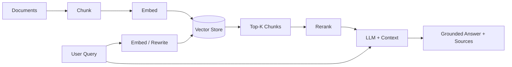

* Ingest documents.
* Parse and chunk.
* Create embeddings/index.
* Embed/rewrite user query.
* Retrieve candidates.
* Optionally rerank.
* Augment prompt.
* Generate grounded response.
* The book explains semantic/vector retrieval alongside BM25 and hybrid search. 
* Video explicitly discusses fixed-size, semantic-boundary and context-aware chunking, query rewriting, top-K retrieval and reranking. ~36:09 onward. ([LilysAI][1])

**Benefits / Drawbacks**

* **Benefits:** current/private knowledge, citations, lower hallucination risk, domain grounding. 
* **Cost:** embedding/index/storage and retrieval infrastructure.
* **Latency:** retrieval + reranking + generation.
* **Failure modes:** bad chunks, missing relevant chunk, poor embeddings, irrelevant top-K, too much retrieved context, stale index.
* The book specifically notes difficulty when necessary evidence is spread across multiple chunks/documents. 

**Example use cases**

* Company-document Q&A.
* Customer support.
* Legal research.
* Product manual assistant.
* Up-to-date research assistant. 

**Variations**

* Vector RAG.
* Keyword/BM25.
* Hybrid retrieval.
* Query rewriting.
* Reranking.
* **GraphRAG** for relationship-heavy questions.
* **Agentic RAG** where an agent reasons about, validates and refines retrieval. 

**Demo app — “Ask Your Python Docs”**

* **Libraries:** LangChain text splitters, `chromadb` or FAISS, embedding model, chat model.
* Index 3–5 Markdown/PDF tutorial docs.
* Retrieve top 4.
* Print retrieved chunks and scores.
* Generate answer with source filenames.

**Episode outline**

* Ask model a fact absent from prompt.
* Build ingestion pipeline.
* Visualize chunks.
* Search embeddings.
* Add generation.
* Demonstrate bad chunk size.
* Add reranking/query rewriting.

---

## 15. Inter-Agent Communication / A2A

**PDF:** Chapter 15, pp. 231–245
**Video:** ~38:14–43:07

* **Overview** — A2A addresses interoperability between independently built agents, potentially running on different frameworks. The book centers the pattern on Google's open **Agent2Agent protocol**, with standardized discovery, tasks, messages, artifacts, and transport. 

**How it works**

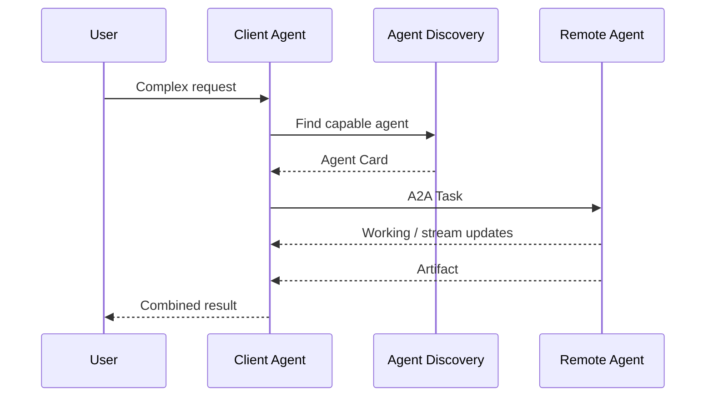

Core book components:

* User.
* A2A client.
* Remote A2A server.
* **Agent Card** describing identity, endpoint, capabilities, skills, modes and auth. 
* Discovery through well-known URI, registry, or direct configuration. 
* Long-running tasks with IDs/state.
* Messages + artifacts.
* Context IDs for continuity.
* HTTP(S) / JSON-RPC communication and synchronous/asynchronous interaction modes. 

The video discusses the broader principle as structured agent messaging with IDs, expiration, identity/security checks and stopping mechanisms. ~38:09–42:50. ([LilysAI][1])

**Benefits / Drawbacks**

* **Benefits:** interoperability, modular agents, independent deployment, dynamic discovery.
* **Cost/latency:** network hop + serialization + remote agent inference.
* **Failure modes:** dead remote agent, auth failure, incompatible schemas, conversation loops, stale messages, context explosion.
* The video highlights debugging/context complexity and the need for explicit loop termination. ([LilysAI][1])

**Example use cases**

* Purchasing agent delegates to supplier agents.
* Travel agent calls flight/hotel specialists.
* Enterprise orchestrator discovers specialized department agents.
* Cross-framework LangGraph ↔ ADK agents.
* Distributed research system.

**Variations**

* Synchronous request/response.
* Async polling.
* Streaming/SSE.
* Direct-config discovery.
* Registry discovery.
* Public well-known discovery.
* Central supervisor vs peer-to-peer communication.

**Demo app — “Two Agents, Two Servers”**

* **Libraries:** A2A Python SDK, Starlette/FastAPI/Uvicorn.
* Server 1: math agent.
* Server 2/client: assistant that discovers math agent.
* Expose an Agent Card.
* Send one task.
* Stream/result artifact back.

**Episode outline**

* Explain why Multi-Agent Collaboration isn't automatically A2A.
* Build remote specialist.
* Publish Agent Card.
* Build client discovery.
* Send task.
* Show task IDs/state.
* Finish with A2A vs MCP.

---

## 16. Resource-Aware Optimization

**PDF:** Chapter 16, pp. 246–261
**Video:** ~43:08–46:34

* **Overview** — Resource-Aware Optimization makes the agent explicitly reason about **compute, time, money, bandwidth or energy** when deciding how to execute a task. 
* It differs from planning: planning decides *what sequence* to execute; resource optimization decides *how much/which resources* to spend executing it.

**How it works**

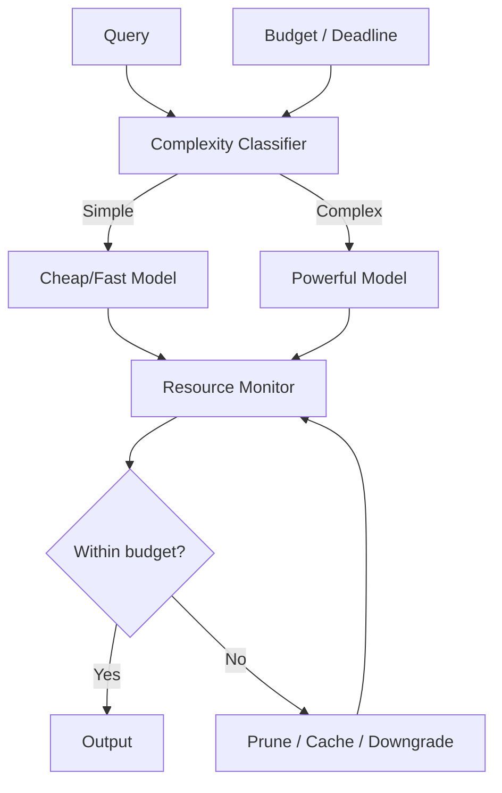

* Establish budget/latency target.
* Classify task complexity.
* Route to appropriate model/tool.
* Measure tokens, money, latency, resource load.
* Adapt if budget is exceeded.
* Gracefully degrade rather than fail.
* The book's concrete example routes simple requests to Gemini Flash and complex work to Pro-class models. 
* Video similarly describes token/time/money budgets and cheap/standard/reasoning model tiers. ~43:09–46:25. ([LilysAI][1])

**Benefits / Drawbacks**

* **Benefits:** lower cost, better throughput, SLA adherence.
* **Failure modes:** classifier sends hard task to weak model; overspending; “complexity” rubric is poorly calibrated.
* **Complexity:** optimization layer itself requires monitoring/testing.
* The video explicitly calls tuning the simple/complex rubric difficult. ([LilysAI][1])

**Example use cases**

* High-volume customer assistant.
* Deadline-sensitive agent.
* Edge-device AI.
* Large-data analysis.
* Multi-agent load balancing. 

**Variations**

The book lists:

* Dynamic model switching.
* Adaptive tool selection.
* Context pruning/summarization.
* Proactive resource prediction.
* Cost-sensitive multi-agent exploration.
* Distributed-compute awareness.
* Learned allocation policies.
* Graceful degradation.
* Priority-based resource allocation. 

**Demo app — “Smart Model Router”**

* **Libraries:** `langchain`, `pydantic`.
* Two models: fast/cheap vs stronger/slower.
* Classify query complexity.
* Maintain `$0.01` pseudo-budget.
* Log model, latency and token estimate.
* Force fallback when budget exhausted.

**Episode outline**

* Run every query on strongest model.
* Calculate waste.
* Build complexity router.
* Add budget state.
* Add fallback.
* Deliberately misclassify a hard question.
* Discuss calibration/evals.

---

## 17. Reasoning Techniques

**PDF:** Chapter 17, pp. 262–285
**Video:** ~46:35–49:56

* **Overview** — This chapter is a family of techniques for problems requiring decomposition, multi-step logical inference, alternative paths and greater test-time computation rather than a single-pass answer. 

**How it works**

A generic reasoning architecture:

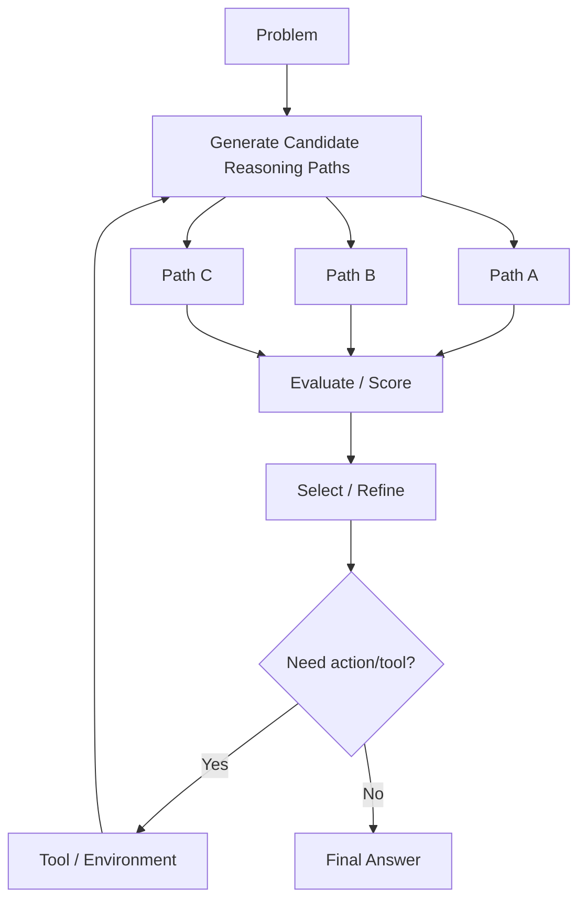

The book explicitly covers:

* **Chain-of-Thought:** structured multi-step reasoning. 
* **Tree-of-Thought:** branch, evaluate, backtrack and explore alternatives. 
* **Self-correction.**
* **ReAct:** Thought → Action → Observation loop using tools. 
* **Chain of Debates:** multiple models critique/counterargue. 
* The video additionally calls out **self-consistency**: generate multiple candidate solutions and score/select them. ([LilysAI][1])

**Benefits / Drawbacks**

* **Benefits:** more robust solutions to difficult math, planning, code and analysis tasks.
* **Cost:** potentially huge token usage because multiple trajectories are generated.
* **Latency:** additional test-time computation directly increases response time.
* **Failure modes:** overthinking, bogus reasoning branches, evaluator selecting a bad candidate, combinatorial branch explosion.
* Video warns that reasoning can “explode” latency/cost and says elaborate techniques are unnecessary for most ordinary tasks. ~49:25–49:45. ([LilysAI][1])

**Example use cases**

* Multi-hop QA.
* Math problem.
* Code debugging.
* Strategic plan.
* Legal analysis. 

**Variations**

* CoT.
* ToT.
* Self-consistency.
* Self-correction.
* ReAct.
* Multi-agent debate/CoD.

**Demo app — “Reasoning Strategy Showdown”**

* **Libraries:** `langgraph`, model package.
* Use one constrained logic puzzle.
* Run:

  1. direct answer,
  2. decomposition,
  3. 3-candidate self-consistency.
* Compare accuracy, calls, tokens and latency.

**Episode outline**

* Begin with failed direct answer.
* Add structured decomposition.
* Add branching.
* Score candidates.
* Add a calculator tool/ReAct.
* Compare cost graph.
* Teach: **more reasoning is a resource decision, not automatically better.**

---

## 18. Guardrails / Safety Patterns

**PDF:** Chapter 18, pp. 286–305
**Video:** ~52:44–56:03 — presented **after Evaluation** in the video

* **Overview** — Guardrails create layered controls around an autonomous agent so unsafe, malicious, biased, irrelevant or policy-violating inputs/actions/outputs are intercepted. 

**How it works**

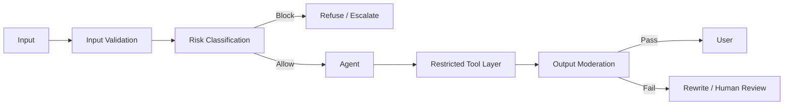

Layers in the book include:

* Input validation/sanitization.
* Output filtering.
* Prompt-level behavioral constraints.
* Tool restrictions.
* External moderation.
* Human intervention. 

The video emphasizes PII detection/redaction, injection detection, risk tiers, output moderation, tool restriction/sandboxing and HITL for high-risk cases. ~52:44–54:57. ([LilysAI][1])

**Benefits / Drawbacks**

* **Benefits:** security, compliance, reduced blast radius, brand/user protection.
* **Latency/cost:** every moderation/classification layer may add an additional call.
* **Failure modes:** false positives, false negatives, bypass/jailbreaks, policy mismatch, unsafe tools despite safe text.
* The video explicitly identifies **false positives and user friction** as major drawbacks. ([LilysAI][1])

**Example use cases**

* Public chatbot.
* Content generation.
* Educational assistant.
* Legal assistant.
* HR/recruiting.
* Scientific assistant. 

**Variations**

* Rules/schema validation.
* LLM guard model.
* External moderation.
* Allowlisted tools.
* Sandboxing.
* Human approval.
* Rate/budget limits.
* **Checkpoint/rollback:** book frames validated states as commits that can be rolled back after unsafe/faulty behavior. 

**Demo app — “Safe Tool-Calling Assistant”**

* **Libraries:** `pydantic`, LangGraph/LangChain.
* Input schema.
* PII scrubber.
* Allowlist of read-only tools.
* Risk classifier.
* Output validator.
* High-risk actions route to human.

**Episode outline**

* Demonstrate unsafe agent with unrestricted tool.
* Add input schema.
* Add PII detection.
* Restrict tools.
* Add output check.
* Test false positive.
* Explain why guardrails must be layered.

---

## 19. Evaluation and Monitoring

**PDF:** Chapter 19, pp. 306–324
**Video:** ~49:57–52:43 — presented **before Guardrails** in the video

* **Overview** — Evaluation and Monitoring measures whether an agent continues to work correctly, efficiently and compliantly. Unlike Goal Monitoring, which guides one agent toward a goal, this chapter focuses on **systematic/external measurement of the agent itself**. 

**How it works**

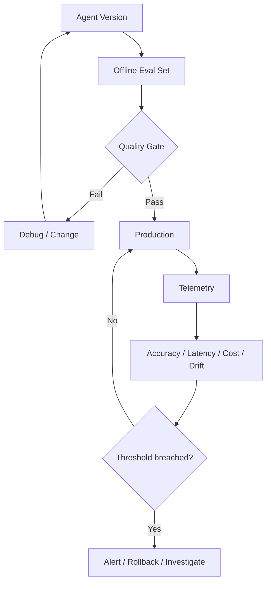

Core measurements include:

* Accuracy/quality.
* Latency.
* Token/resource usage.
* Tool success.
* Safety/compliance.
* Drift.
* Anomalous actions.
* Agent trajectories.
* The book describes exact match, string/semantic metrics, RAG metrics and LLM-as-a-Judge.  
* Video stresses golden tests before deployment and ongoing accuracy/performance/cost/drift monitoring. ~49:57 onward. ([LilysAI][1])

**Benefits / Drawbacks**

* **Benefits:** catches regressions, drift and unsafe behavior; allows controlled iteration/A-B tests.
* **Cost:** storing traces + running evals/judges can be expensive.
* **Latency:** synchronous online checks can affect response time; async monitoring avoids some user-facing latency.
* **Failure modes:** weak eval set, judge bias, optimizing to benchmarks, alert fatigue, missing long-tail failures.
* The video explicitly cites alert fatigue and performance overhead. ([LilysAI][1])

**Example use cases**

* Production chatbot SLAs.
* A/B agent versions.
* Compliance audit.
* Drift detection.
* Learning-progress tracking. 

**Variations**

* Offline golden-set evals.
* Online telemetry.
* Deterministic unit tests.
* LLM-as-judge.
* Human evaluation.
* Trajectory/tool-call evaluation.
* A/B testing.
* Drift/anomaly detection.

**Demo app — “Mini Agent Eval Harness”**

* **Libraries:** `pytest`, `time`, optional `langsmith`.
* Ten test prompts.
* Expected tool + answer rubric.
* Record:

  * correctness
  * latency
  * tool used
  * number of calls
* Print small report before/after prompt change.

**Episode outline**

* Change a prompt and accidentally break three cases.
* Introduce golden dataset.
* Compute success rate.
* Add latency/tool metrics.
* Add LLM judge for subjective case.
* Demonstrate judge disagreement.
* Separate offline eval from production monitoring.

---

## 20. Prioritization

**PDF:** Chapter 20, pp. 325–334
**Video:** ~56:04–59:28

* **Overview** — Prioritization solves the problem of agents having more possible tasks/actions than they can execute simultaneously. It ranks work using criteria such as urgency, importance, dependencies, resource availability and cost/benefit. 

**How it works**

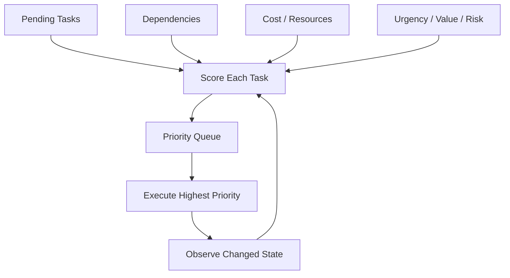

* Establish criteria.
* Score each candidate.
* Apply dependency constraints.
* Rank/schedule.
* Execute top candidate.
* Re-score as environment changes.
* Prioritization can operate at goal, sub-task or immediate-action level. 
* The video proposes value/risk/effort/urgency-style scoring, dependency graphs, queue scheduling and repeated re-prioritization. ([LilysAI][1])

**Benefits / Drawbacks**

* **Benefits:** adaptability, transparent task ordering, better use of limited resources.
* **Cost:** evaluation/re-ranking itself consumes compute.
* **Failure modes:** bad scoring formula, starvation of low-priority work, constantly changing ranking, inconsistent LLM judgments.
* Video calls out context switching and difficulty making reprioritization deterministic. ([LilysAI][1])

**Example use cases**

* Support-ticket queue.
* Cloud scheduler.
* Autonomous driving actions.
* Trading opportunities.
* Project-management tasks.
* Cybersecurity alerts. 

**Variations**

* Fixed priority.
* Numeric weighted score.
* Priority queue.
* Dependency-aware DAG.
* LLM ranking.
* Aging to avoid starvation.
* Dynamic re-prioritization.
* Human-set overrides.

**Demo app — “AI Project Manager”**

* **Libraries:** `pydantic`, `heapq`, optional LangChain.
* Add 8 tasks.
* LLM extracts urgency/value/risk.
* Deterministic formula computes score.
* Respect dependencies.
* Execute one task.
* Introduce emergency issue and rerank.

**Episode outline**

* Show unordered todo list.
* Define task schema.
* Create score.
* Add dependency graph.
* Build priority queue.
* Inject urgent event.
* Explain why LLM should suggest factors while deterministic code can own final arithmetic.

---

## 21. Exploration and Discovery

**PDF:** Chapter 21, pp. 335–347
**Video:** ~59:29–1:02:11

* **Overview** — Exploration and Discovery targets **open-ended spaces where the answer or even the important questions are not yet known**. Instead of optimizing a known process, an agent searches for novel information, opportunities, hypotheses and “unknown unknowns.” 

**How it works**

```mermaid
flowchart TD
    G[Research Goal] --> X[Explore Broad Sources]
    X --> K[Map Knowledge Space]
    K --> C[Cluster Themes]
    C --> N[Score Novelty / Impact / Feasibility]
    N --> I[Deep Investigation]
    I --> H[Generate Hypotheses]
    H --> E[Evaluate / Debate]
    E -->|Promising| I
    E -->|Enough evidence| R[Research Report + Next Questions]
```

The video gives nearly exactly this pipeline:

1. Start with research goal.
2. Explore papers/data/experts.
3. Map knowledge space.
4. Cluster themes.
5. Score novelty, impact, gaps, feasibility.
6. Investigate promising areas.
7. Extract artifacts.
8. Synthesize insights/hypotheses.
9. Loop.
10. Produce findings + recommended next steps. ~59:23–1:01:30. ([LilysAI][1])

The book's AI Co-Scientist example uses specialized **Generation, Reflection, Ranking, Evolution, Proximity, and Meta-review agents** in an iterative generate/debate/evolve system. 

**Benefits / Drawbacks**

* **Benefits:** novel hypotheses, discovery of hidden relationships, broader search than a human may practically perform.
* **Cost:** extremely high when many sources/candidates/agents are explored.
* **Latency:** potentially long-running research.
* **Failure modes:** chasing novelty without usefulness, weak source quality, hallucinated discoveries, confirmation bias, enormous search spaces.
* The book notes the Co-Scientist still inherits LLM hallucination limits and can miss inaccessible/paywalled or unpublished negative evidence. 
* The video calls the pattern explicitly **time-sensitive and resource-heavy**. ([LilysAI][1])

**Example use cases**

* Scientific hypothesis generation.
* Drug/material discovery.
* Market opportunity research.
* Game strategy discovery.
* Creative exploration.
* Vulnerability research in authorized environments. 

**Variations**

* Single research agent.
* Multi-agent generate/critic/ranker.
* Evolutionary hypothesis search.
* Novelty search.
* Deep Research-style iterative search.
* Scientist-in-the-loop.
* RAG + reasoning + prioritization + evaluation hybrid.

**Demo app — “AI Research Idea Explorer”**

Keep it small enough for YouTube:

* **Libraries:** `langgraph`, `pydantic`.
* Give the app 10 short paper abstracts in a local JSON file.
* Generator proposes 5 research ideas.
* Critic scores novelty + feasibility.
* Ranker selects top 2.
* Evolution step combines/refines them.
* Stop after two rounds.

**Episode outline**

* Explain “optimization” vs “exploration.”
* Load miniature knowledge space.
* Generate candidates.
* Add critic/ranker.
* Add one evolution round.
* Visualize score progression.
* End by showing how this single app combines RAG, parallelization, reflection, prioritization and multi-agent collaboration.

---

# Series-level progression

The ordering in the book works particularly well for a tutorial series because complexity builds naturally. The early chapters establish control-flow primitives; middle chapters add action, memory, adaptation and external interfaces; later chapters focus on production reliability, judgment and autonomy. The book itself says the chapters are ordered progressively and uses LangChain/LangGraph, CrewAI and Google ADK as its primary implementation canvases.  

For a coherent Python series, I would **not** switch frameworks every episode even though the book does. A cleaner teaching stack would be:

**Python + LangChain/LangGraph + Pydantic as the default**, then introduce specialized libraries only when the pattern requires them—`FastMCP` for MCP, an A2A library for A2A, a vector DB for RAG, and `pytest`/LangSmith-style tooling for evaluation. This makes each episode teach the *pattern* rather than forcing viewers to relearn an API.

# Quick reference

| Pattern                         | Best for                                    | Avoid when                                            | Demo app                        |
| ------------------------------- | ------------------------------------------- | ----------------------------------------------------- | ------------------------------- |
| Prompt Chaining                 | Dependent multi-stage transformations       | One prompt reliably solves task                       | AI blog pipeline                |
| Routing                         | Choosing among workflows/tools/agents       | Only one path exists                                  | Help-desk router                |
| Parallelization                 | Independent slow operations                 | Tasks depend on each other                            | Parallel research brief         |
| Reflection                      | Quality-critical iterative work             | Latency/cost dominate                                 | Self-improving coder            |
| Tool Use                        | External data/actions                       | Pure text generation is enough                        | SQLite data agent               |
| Planning                        | Goal known, path unknown                    | Workflow is already deterministic                     | File organizer                  |
| Multi-Agent Collaboration       | Distinct specialist roles                   | One agent can do the job cleanly                      | AI content team                 |
| Memory Management               | Continuity/personalization                  | One-shot stateless task                               | Remembering study buddy         |
| Learning & Adaptation           | Improvement from feedback                   | Stable behavior is more important                     | Feedback-learning support agent |
| MCP                             | Reusable external integrations              | A few fixed local functions                           | Python MCP todo server          |
| Goal Setting & Monitoring       | Autonomous goal completion                  | Single simple operation                               | Code-until-tests-pass           |
| Exception Handling              | Real-world unreliable dependencies          | Practically never for production                      | Resilient API agent             |
| Human-in-the-Loop               | Risky/ambiguous decisions                   | Fully automated low-risk bulk work                    | Expense approval                |
| Knowledge Retrieval / RAG       | Private/current factual knowledge           | Model already has all required context                | Ask-your-docs                   |
| Inter-Agent Communication / A2A | Distributed independent agents              | Agents all live inside one simple process             | Two-agent A2A system            |
| Resource-Aware Optimization     | Cost/latency constraints                    | Low-volume app with negligible cost                   | Smart model router              |
| Reasoning Techniques            | Hard multi-step problems                    | Straightforward tasks                                 | Reasoning strategy showdown     |
| Guardrails / Safety             | User/system-impacting agents                | Essentially never omit from exposed production agents | Safe tool assistant             |
| Evaluation & Monitoring         | Production reliability/regression detection | Throwaway prototype                                   | Mini eval harness               |
| Prioritization                  | Competing tasks/goals                       | Only one available action                             | AI project manager              |
| Exploration & Discovery         | Open-ended research/innovation              | Known deterministic problem                           | Research idea explorer          |

The strongest arc for the series is that **each episode can reuse code from earlier patterns**: Routing can reuse Prompt Chaining, Reflection can become a LangGraph loop, Planning can add Tool Use, Multi-Agent can add Parallelization, RAG can become a tool, Resource Optimization can route models, and the final Exploration episode can deliberately combine most of the earlier patterns into one miniature research system.

[1]: https://lilys.ai/en/notes/agentic-ai-20251022/master-agentic-ai-design-patterns "Master ALL 20 Agentic AI Design Patterns [Complete Course]"
[2]: https://www.youtube.com/watch?v=e2zIr_2JMbE&utm_source=chatgpt.com "Master ALL 20 Agentic AI Design Patterns [Complete Course] - YouTube"
